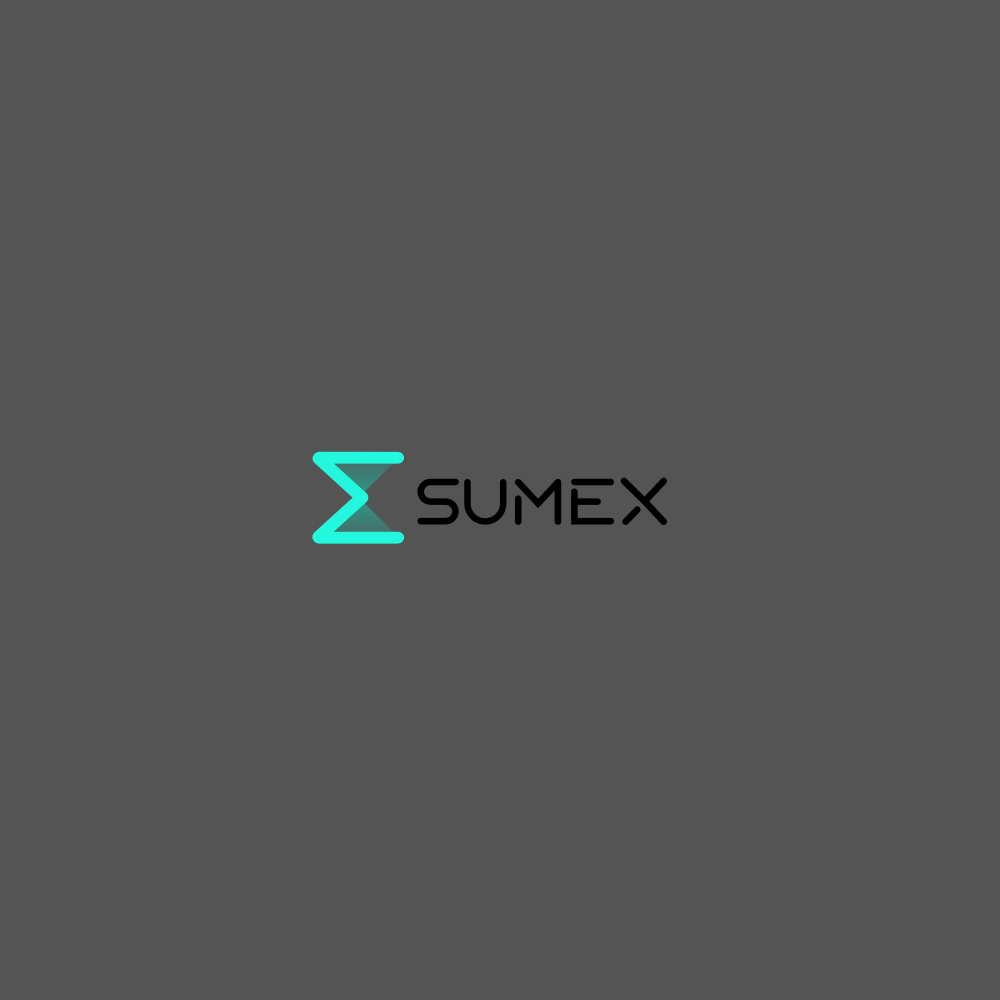

# Sumex Market Intelligence Desk

An internal market intelligence desk for Sumex that continuously monitors crypto market movements, macroeconomic event releases, US spot ETF flows, and breaking crypto catalysts - detecting meaningful anomalies, organizing them into structured research cards, and formulating AI-assisted editorial drafts.



---

## 🎨 Sumex Brand Identity
* **Primary Color**: `#23F7DD` (Electric Cyan)
* **Secondary Color**: `#8E33FF` (Neon Purple)
* **Design Language**: Cyber-institutional dark mode, high-contrast typography, glassmorphism accents, live pulsing status dots.

---

## 🏛️ Application Architecture & Desks

| Route | Workspace | Purpose |
| :--- | :--- | :--- |
| [`/dashboard`](app/(protected)/dashboard) | **Intelligence Dashboard** | 30-second situational awareness: BTC/ETH/SOL/HYPE spot tickers, global market cap & dominance, ETF daily net strip, open signals, macro releases, data feed health. |
| [`/market`](app/(protected)/market) | **Market Overview Desk** | Multi-timeframe deltas (1h, 24h, 7d), sector/narrative momentum tracker, searchable watchlist, immutable snapshot audit log. |
| [`/signals`](app/(protected)/signals) | **Signal Feed & Catalysts Wire** | Algorithmic threshold scanner, multi-factor scoring (magnitude, abnormality, confirmation), and breaking news wire (Cointelegraph, Decrypt, The Block) with one-click research card generation. |
| [`/research`](app/(protected)/research) | **Research Workspace** | Observation, thesis formulation, verified facts, contradicting evidence, confidence rating, invalidation criteria, and AI Draft Engine. |
| [`/content`](app/(protected)/content) | **Content Drafts Workspace** | Multi-format editorial pipeline (Market Pulse, Why It Moved, Macro to Crypto, ETF Watch, Weekly Recap) with markdown editor and approval workflows. |
| [`/macro`](app/(protected)/macro) | **Macro Calendar Desk** | CPI, FOMC, and Employment releases with previous, forecast, actual tracking, and market reaction notes. |
| [`/etf`](app/(protected)/etf) | **Spot ETF Flows Desk** | US spot Bitcoin and Ethereum ETF daily net flows, institutional fund breakdown, and rolling totals. |
| [`/settings`](app/(protected)/settings) | **System Settings & Admin** | Signal engine sensitivity threshold configuration with database persistence, user role management, and monitored asset watchlist. |

---

## ⚙️ Environment Variables

Create a `.env.local` file in the root of `sumex_app`:

```bash
# Supabase Configuration
NEXT_PUBLIC_SUPABASE_URL=https://your-project.supabase.co
NEXT_PUBLIC_SUPABASE_ANON_KEY=your-anon-key
SUPABASE_SERVICE_ROLE_KEY=your-service-role-key

# AI Provider API Keys (Optional - Fallbacks to structured markdown template if unset)
GOOGLE_AI_API_KEY=your-gemini-api-key
OPENAI_API_KEY=your-openai-api-key

# Cron Secret (Optional - for securing external webhook calls in production)
CRON_SECRET=your-cron-secret
```

---

## 🚀 Running Locally

```bash
# Install dependencies
npm install

# Start development server
npm run dev
```

Visit [http://localhost:3000](http://localhost:3000).

---

## ⏱️ Automated Background Ingestion (Vercel Crons & In-App Sync)

Configured in [`vercel.json`](vercel.json):
* **`/api/cron/fetch-market-data`**: Runs every 5 minutes (`*/5 * * * *`) - Ingests live prices, volume, & triggers signal evaluation
* **`/api/signals/scan`**: Runs every 5 minutes (`*/5 * * * *`) - High-frequency threshold anomaly evaluation
* **`/api/cron/fetch-news`**: Runs every 15 minutes (`*/15 * * * *`) - Ingests breaking RSS crypto headlines
* **`/api/cron/fetch-etf-flows`**: Runs 3x daily during market hours (`0 14,18,22 * * 1-5`)
* **In-App Auto-Sync**: The application shell includes an active client-side auto-sync engine with configurable intervals (1m, 2m, 3m, 5m, or Paused) with live countdown & force-sync controls.

